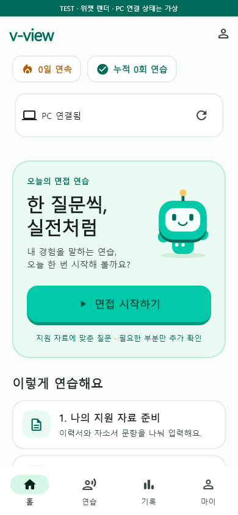
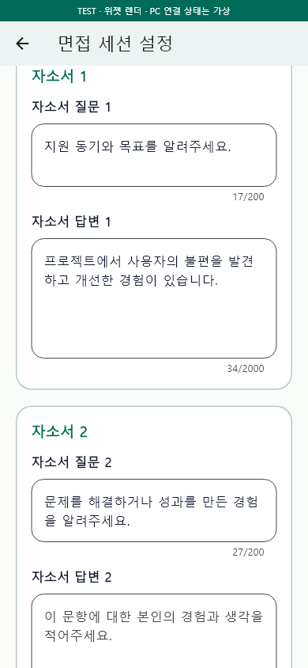

# v-view · 면접 연습을 기록하는 Flutter 앱

문항별 지원 자료를 입력하고, 시작 후 한 질문씩 답하며, 음성·텍스트 답변과 얼굴 방향 기반 응시 지표를 피드백 리포트로 연결합니다.
검토자는 로그인·API 키 없이 별도 포트폴리오 데모를 실행할 수 있습니다.

> 현재 실제 AI는 클라우드 배포 없이 개인 PC의 GPT 키로 사용합니다. 앱 코드 → PC → OpenAI의 질문·꼬리질문·평가 연결을 확인했습니다. 휴대폰 음성 인식과 iOS 실행은 추가 검증이 필요하며 샘플 화면은 사용자 성과가 아닙니다.

## 먼저 보기

<p>
  
  
</p>

위 화면은 TEST 표시가 있는 Flutter 위젯 렌더링이며, 실제 사용자 자료·기기 연결 성과가 아닙니다.

- [프로젝트 설명·문제 해결·본인 기여 작성 자료](docs/PORTFOLIO-V-VIEW.md)
- [검증 환경·결과·화면 증거](docs/verification/README.md)
- [90초 시연 순서와 공개 전 남은 일](docs/PORTFOLIO-READY.md)

## 키 없이 데모 실행

Flutter 3.38.9 / Dart 3.10.8을 기준으로 확인했습니다. Android SDK와 에뮬레이터 또는 휴대폰이 필요합니다.

```sh
cd v_view
flutter pub get
flutter run -t lib/main_demo.dart
```

Firebase 로그인·외부 AI 호출 없이 샘플 질문 → 직접 입력 → 샘플 규칙 피드백 → 기록 재열람을 제공합니다.
카메라·마이크를 사용하지 않습니다. 가상 리포트 2개로 이전 연습 비교를 확인할 수 있습니다.
면접 화면의 ‘샘플 답변 넣기’로 질문에 맞는 한국어 예시를 채운 뒤 수정하거나 다음 질문으로 진행할 수 있습니다. 이미 작성한 답변은 덮어쓰지 않습니다.
데모 기록은 `portfolio_demo` 하위 저장소를 사용해 실제 앱 기록과 분리합니다.

## 구현한 기능

| 기능 | 동작 |
|---|---|
| 지원 자료 | 이름 없이 선택 나이·학교·학력·여러 자격증, 이력서 요약, 자소서 질문·답변 1·2·3. 학교·자격명 검색 및 직접 추가, 기존 소개 호환·기기 저장·초기화 |
| 질문·꼬리질문 | 시작 후 현재 질문만 공개. 답변 맥락에 따라 필요한 확인·근거 질문만 삽입하며 횟수 제한 제거. 실제 답변 인용 검증·반복 차단·수동 건너뛰기 |
| 음성 답변 | 기기 음성 인식 → 텍스트 확인·수정 → 제출 → AI 요청 입력 |
| 면접 진행 | 질문별 준비 시간 없음·15·30초, 답변 종료 후 직접 제출·30초 연장, 빈 답변 건너뛰기 확인, 일시정지·재개 |
| 카메라 | 사용 여부 선택. 준비·대기·일시정지 구간을 측정에서 제외하고, 카메라를 끄면 미측정 이유 표시 |
| 리포트 | 완료율·시간·측정 품질·피드백 근거·질문별 실제 답변 |
| 이전 연습 비교 | 같은 유형·직무·회사에서 완료율·정상 품질 응시율·평균 답변 시간의 차이 |
| 기록 | Hive 저장·재열람, 측정 불가를 응시율 0점으로 표시하지 않음 |
| 저장 오류 복구 | 답변·피드백을 화면에 유지하고 복사 가능. AI 재호출 없이 같은 ID로 저장만 재시도 |
| 기록 삭제 | 목록 요약과 상세 답변을 함께 삭제하고 쓰기 완료를 기다림. 오류 시 재시도 |
| 리포트 복사 | 새 리포트·저장 기록에서 질문·답변·시간·피드백 근거를 Markdown으로 복사. 데모 표시 유지 |
| 로컬 AI | Firebase 로그인 없이 PC의 GPT 키로 실제 질문·평가. 앱에 키를 넣지 않고 localhost에서만 실행 |
| 연습 이어하기 | 작성 중 답변·질문·남은 시간을 임시 저장하고 일시정지 상태로 복구 |
| 피드백 재연습 | 미평가 기록의 평가 재시도, 이전 답변·피드백을 참고해 같은 질문에 새로 답하기 |

학교·자격증 검색은 앱에 포함한 입력용 기본 목록을 사용합니다. 과거 명칭이 포함될 수 있으며, 현재 시행 자격이나 취득 사실을 검증하지 않습니다. [목록 출처·기준일·갱신 방법](v_view/assets/catalogs/SOURCES.md)을 참고하세요.

답변 완료율은 역량 점수가 아닙니다. 시선 분석은 정밀한 눈동자 추적이 아니며 발음·억양·표정은 평가하지 않습니다.

2026-11-09 후속 개선에는 320×740 화면·글자 1.6배·화면 키보드 조건의 입력·제출 테스트를 포함했습니다. [앱이 생성한 가상 리포트 내보내기 예시](docs/verification/v-view-export-sample-2026-11-09.md)도 확인할 수 있습니다.

## 실제 AI 모드

현재는 **개인 PC 모드**를 사용합니다. [로컬 실행 안내](docs/LOCAL-AI.md)에 키 준비·Android USB 연결·설치 파일 사용법을 정리했습니다. Google Cloud 배포와 Firebase 로그인은 필요하지 않습니다.

```powershell
cd server
npm run local:setup
npm start
```

다른 PowerShell 창에서 Android 휴대폰 또는 에뮬레이터를 연결한 뒤:

```powershell
.\scripts\Run-LocalAndroid.ps1
```

앱은 `.env`를 읽거나 자산에 포함하지 않습니다. PC의 `server/.env.local`만 키를 사용하며 기존 프로젝트 키를 값 노출 없이 옮기는 준비 명령을 제공합니다. PC 프로세스가 꺼지면 새 AI 요청은 사용할 수 없습니다. 실패를 샘플 결과로 숨기지 않습니다.
기본 `main.dart`와 `main_local.dart`는 실제 카메라·마이크를 사용하고 기록은 `local_ai` 저장소에 남깁니다. 기존 Firebase 진입점은 `main_firebase.dart`에 보관하며 현재 실행 경로에서 사용하지 않습니다.

## 검증 실행

```sh
cd v_view
flutter test --no-pub --reporter expanded
flutter analyze --no-pub
```

```sh
cd server
npm ci --ignore-scripts --omit=optional
npm test
npm audit --omit=dev --omit=optional
```

테스트는 외부 AI 과금 호출 없이 실행합니다. GitHub Actions 설정은 테스트·분석을 자동 실행하도록 구성했으며 원격 실행 여부는 검증 기록에서 구분합니다.

## 구조와 자료

`UI → Riverpod 상태 → 서비스·데이터 소스`, 각 부분에서 질문·리포트 Domain 모델을 공유합니다.
Flutter/Dart, Riverpod, Dio, Hive, ML Kit, speech_to_text, Firebase Auth·Firestore, Node.js·Firebase Admin을 사용합니다.

- [환경 설정](docs/SETUP.md), [빌드·배포](docs/DEPLOY.md)
- [구조](docs/ARCHITECTURE.md), [설계 결정 기록](docs/ADR/)
- [음성 답변과 검증 범위](docs/VOICE-ANSWERS.md)
- [도구와 설치한 스킬](docs/DEVELOPMENT-TOOLS.md)

개발 기간·팀 구성·개인 기여는 소유자가 실제 수행한 내용으로 확정해야 합니다. AI 생성 코드와 개발자가 결정·검증한 내용을 구분해 공개합니다.

## 기존 발표 자료

- [발표 페이지](https://thswjdguq.github.io/v-view/) · [슬라이드](docs/slides.html)
- [기존 시연 영상](https://www.youtube.com/watch?v=nBDNsB4vvYc) — 최신 후속 기능 전체를 담은 영상은 아닙니다.

개발 기간은 1학기이며, 이후 개인 포트폴리오용 후속 개선을 포함합니다. 후속 코드·테스트·검증 자료에는 Codex의 생성·수정·검증 작업이 포함됩니다.
