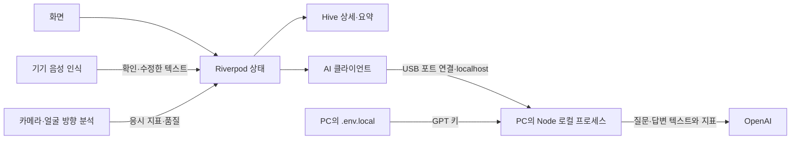
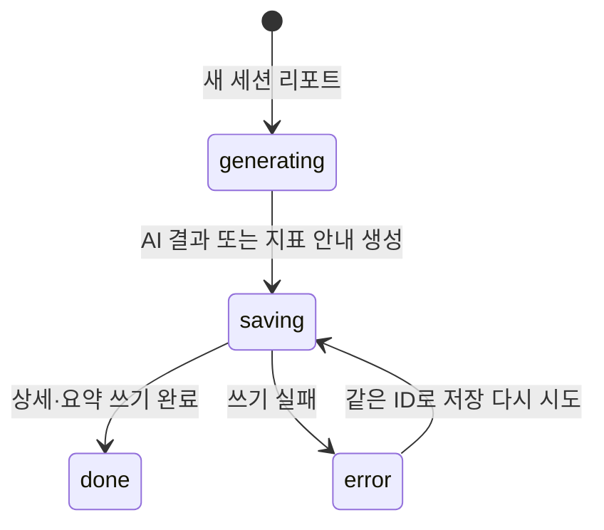

# v-view 구조와 데이터 흐름

2026-11-19 로컬 소스 기준. 사용자 요청으로 클라우드 배포는 진행하지 않는다. 현재는 개인 PC의 GPT 키로 실제 질문·꼬리질문·평가를 처리한다. 실행 증거는 [검증 기록](verification/README.md)을 따른다.

## 실행 모드

| 진입점 | 의존성과 데이터 |
|---|---|
| `v_view/lib/main.dart` / `main_local.dart` | 기본 실행. Firebase 로그인 없이 실제 GPT API·카메라·마이크. PC와 USB 포트 연결, Hive `local_ai` 경로 사용 |
| `v_view/lib/main_firebase.dart` | 보관한 기존 경로. Firebase 초기화·로그인과 HTTPS 중계 주소 필요 |
| `v_view/lib/main_demo.dart` | Firebase·외부 AI·카메라·마이크 없이 가상 질문과 샘플 규칙. Hive `portfolio_demo` 경로 사용 |

앱은 `.env`를 읽거나 자산에 포함하지 않는다. PC가 `server/.env.local`의 키로 OpenAI에 요청하며 로컬 앱에는 PC의 loopback 주소만 설정한다. 로컬·데모 진입점은 API와 면접·리포트 Provider를 같은 Scope에 연결한다. 기존 Firebase 경로는 보관 중인 별도 기능이다.

## 주요 구성

| 경로 | 책임 |
|---|---|
| `v_view/lib/ui/` | 입력·질문·면접·새 리포트·저장 기록 화면 |
| `v_view/lib/state/` | Riverpod 상태, 면접 진행·시간, 생성·저장 작업의 수명 관리 |
| `v_view/lib/domain/` | 질문·답변·지원 정보·응시 지표·리포트 등 공통 모델 |
| `v_view/lib/services/speech_service.dart` | 공유 음성 인식기, 부분/최종 텍스트 병합과 시작·종료 직렬화 |
| `v_view/lib/data/local/` | Hive 직렬화·조회·저장, 상세/요약의 삭제 작업 |
| `v_view/lib/data/remote/ai/claude_api_service.dart` | Dio 요청, 토큰 조회, AI JSON 파싱·오류 변환. 기존 클래스명을 유지하며 실제 요청은 OpenAI 중계 형식 사용 |
| `v_view/lib/data/remote/gaze/` | 카메라 프레임 변환과 ML Kit 얼굴 방향 분석 |
| `server/src/local.js` | 127.0.0.1 전용 로컬 프로세스. Firebase·클라우드 인증 없이 PC 키 사용 |
| `server/src/app.js` | 공통 입력 검증·요청 제한·고정 모델 API 요청. 로컬 경로는 Origin·Host·접속 주소 검증, 기존 Firebase 경로는 토큰·허용 UID 검증 |
| `server/scripts/` | 검토용 배포 계획 생성과 Cloud Shell 소스 묶음 생성 |

## 실제 모드의 흐름

현재 경로에는 Firebase 인증·클라우드 배포가 없다. PC 프로세스는 loopback에서만 수신하고 웹 Origin·외부 Host·비로컬 접속을 차단한다. `/health` 응답은 PC 상태만 확인하며 GPT 키의 실제 유효성을 뜻하지 않는다. 실제 GPT 연결과 가상 문답별 판단은 별도 호출로 확인하며, 성공·오류 사례는 검증 기록에 구분한다.

앱은 AI에 음성 파일이나 카메라 원본을 보내지 않는다. 음성 인식 자체는 기기 플랫폼 엔진을 사용하므로 모든 처리가 기기 안에서 끝난다고 주장하지 않는다. 인식 텍스트를 사용자가 확인·수정한 후 답변으로 제출하고 관련성·구체성·구조 피드백의 입력으로 쓴다. 발음·억양·표정 점수를 만들지 않는다. 로컬 모드에서도 지원 정보·답변·지표가 OpenAI로 전송되므로 ‘모든 데이터가 기기 안에만 남음’이라고 설명하지 않는다. 기존 Firebase 모드에는 Auth·Firestore 사용자 프로필 처리도 있다.

## 리포트 생성과 저장 복구

`ReportNotifier`는 시작 시점의 답변 목록을 고정하고 생성한 결과와 요약을 한 쌍으로 보관한다. 저장 실패에도 화면에서 질문·답변·피드백을 확인하고 복사할 수 있다. 재시도는 AI 생성 단계로 돌아가지 않으며 같은 ID·작성 시각·피드백으로 디스크 쓰기만 수행한다. 중복 재시도는 `saving` 상태에서 차단한다.

세대 번호로 이전 AI 응답을 저장하기 전에 무시하고, 이미 시작한 이전 저장의 완료가 새 상태를 덮어쓰지 않게 한다. 두 box 쓰기는 원자적이지 않다. 부분 성공은 같은 ID로 재시도해 정리하며, 메모리에 둔 미완료 리포트의 앱 강제 종료 후 자동 복구는 구현하지 않았다.

## 기록과 비교

`reports` box는 실제 질문·답변·답변 시간·피드백·측정 품질을 저장한다. `history` box는 같은 ID의 목록 요약과 직무·회사 정보를 저장한다. 새 리포트와 과거 상세 화면은 `ReportContent`를 공유한다.

비교는 이전 기록 중 면접 유형·직무·회사가 같은 가장 가까운 기록으로 제한한다. 완료율은 답변 작성 비율, 응시율 차이는 양쪽 모두 정상 품질인 경우만 제공한다. 평균 답변 시간은 길거나 짧은 것이 더 우수하다는 점수로 사용하지 않는다.

개별·전체 삭제는 상세와 요약을 함께 기다리고 실패 시 재시도한다. 전체 삭제는 시작 시점의 ID 집합으로 범위를 고정한다. 삭제와 저장 모두 여러 box에 걸친 원자적 트랜잭션이나 자동 복구 저널을 제공하지 않는다.

## 검증 경계

상태·화면·실제 임시 Hive 자동 테스트는 외부 AI를 대체한다. 별도 수동 검증에서 가상 지원 정보로 실제 GPT 요청 3회와 앱의 응답 파싱을 확인했다. Android 데모 시연은 가상 데이터로 확인했다. 휴대폰 마이크·iOS와 기존 Firebase 인증 경로는 별도 검증이 필요하다. 상세 조건은 [검증 기록](verification/README.md), 실행은 [로컬 AI 안내](LOCAL-AI.md)를 참고한다.

## 지원 자료와 순차 면접 (2026-11-17)

`SessionInput`은 이름 필드 없이 선택 나이·학력·자격증, 이력서 요약과 `ApplicationEssay(question, answer)` 목록을 보관한다. 화면은 세 문항을 제공하며 요약 또는 문항 답변 하나 이상이면 유효하다. 나이·학력·자격증은 시작 조건이 아니다. 이 정보 자체로 능력이나 압박 여부를 판단하지 않도록 질문 생성 지침에 명시했다.

`session_input`과 `InterviewDraft`가 같은 `toMap/fromMap`을 사용해 문항 경계와 질문 수·시간을 유지한다. 이전 `selfIntroduction` 형식도 읽는다. 새 연습에서는 자료를 재사용하며 사용자가 설정의 ‘입력 내용 초기화’를 선택하면 비운다. 질문 생성에는 문항별 JSON을 보내고 이름 키를 만들지 않는다. 자유 입력에 사용자가 쓴 개인정보까지 자동 익명화하지는 않는다.

설정 → 시작 전 확인 → ‘면접 시작’ → 질문 준비 → 첫 질문 순서다. 기존 `QuestionListScreen` 이름은 호환성을 위해 유지하지만 목록을 렌더링하지 않는다. 준비 성공 시 `InterviewScreen`으로 자동 이동하고 현재 질문만 표시한다. 새 홈은 실제 저장 횟수·연속 연습일만 표시하며 역량 점수나 가상 XP를 만들지 않는다.

## 필요한 추가 확인과 임시 복구

`generateFollowUp`은 이전 문답과 현재 답변을 받아 `clarification/challenge`, 이유, 실제 답변의 인용을 요구한다. 깊이 상한을 없애고 중복 질문·근거 없는 인용·중복 제출·늦은 응답을 앱에서 방어한다. 충분하면 다음 기본 질문으로 넘어간다. 사용자는 추가 질문 대신 기본 질문으로 이동할 수 있다. 형식·인용 검증 실패도 안내 후 기본 질문을 진행한다. 이 검증은 모델 판단 자체의 정확성을 보장하지 않는다.

로컬 면접은 질문·답변·시간·입력 자료를 임시 저장한다. 입력 변경은 400ms 지연 저장, 시간은 5초 간격 저장을 예약하며 제출·나가기에서 저장을 기다린다. 복구는 AI 호출 없이 일시정지 상태로 열고 시선은 복구 후 새 측정 구간만 참고용으로 표시한다. 원본 영상이나 시선 프레임을 디스크에 복구하지 않는다. 강제 종료 직전 변경과 아직 생성·저장되지 않은 AI 피드백까지 모두 복구하는 트랜잭션은 아니다.

미평가 저장 리포트는 사용자 요청으로 AI 평가를 다시 받고 같은 ID에 저장한다. 저장 실패 시 생성된 평가를 메모리에 유지해 저장 재시도에서 AI를 반복 호출하지 않는다. ‘피드백 보며 같은 질문으로 연습’은 기본 질문을 재사용해 새 세션을 만들고 이전 답변·피드백을 참고로 표시한다.

## 검색 목록과 준비·답변 시간 분리 (2026-11-19)

`ProfileCatalogDatasource`는 `assets/catalogs/`의 공개 명칭 JSON을 읽고 `profileCatalogProvider`가 비동기 로딩·오류·다시 불러오기를 관리한다. 검색 자체는 HTTP 요청 없이 이름·약칭·학교 지역을 정규화해 처리한다. 선택은 검색 화면의 임시 목록으로 유지하다 완료 시에만 반영한다. 로딩 실패에도 직접 추가할 수 있고, 검색 상단과 결과는 하나의 스크롤 안에 두어 큰 글자·키보드 상태에서 완료 버튼이 가려지지 않게 한다.

`SessionInput.school`은 학교명, `certificates`는 여러 자격의 원본 명칭 배열이다. 기존 `certifications` 문자열은 호환성을 위해 유지하며 이전 값은 구분자 기준으로 읽는다. 새 배열에서는 이름에 쉼표가 들어가도 하나의 항목으로 유지한다. AI 입력에도 자격명 배열과 학교명을 전달한다. 직접 입력한 명칭을 취득·학적 사실로 검증하지는 않는다.

`InterviewState.preparationSecondsRemaining`은 `timerSeconds`와 별개다. 준비 단계 tick은 준비 시간만 줄이며 답변 소요 시간과 시선 지표에 포함하지 않는다. 시간 종료는 다음 질문을 자동 실행하지 않고 0초 상태로 머문다. 연장은 사용자 요청으로 30초를 제공하며 AI 호출을 만들지 않는다. 임시 기록은 남은 준비 시간을 저장하고 이전 형식은 준비 시간 0초로 복구한다.

`GazeFrame.segmentId`는 연속 측정 구간을 구분한다. 일시정지·재개에서 구간을 바꾸고 해당 구간의 시작 전 요청한 프레임은 도착해도 버린다. 분산 시간 계산은 구간 경계에서 닫아 준비·대기 시간을 가로질러 합산하지 않는다. 기존 1초 분산 임계값과 실제 프레임 기준 응시율 공식은 유지한다. 카메라 비사용은 미측정 사유가 있는 지표로 리포트에 전달한다.
